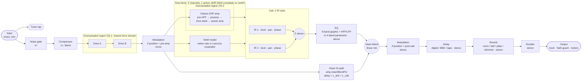

# Signal flow

- Status: draft spec (issue #22). Date: 2026-10-25. Owner: architect (acct3/Moth).
- Rests on: `docs/research/reference-plugins.md` (R1, Q1–Q5), `oversampling.md` (§3.1, §3.4), `nam-runtime.md` (§3),
  `time-based-effects.md` (Q1, Q2, Q4), `tone-targets-a.md`/`-b.md`, ADR-0002 (D4, amp-slot latency),
  ADR-0004 (threading), ADR-0005 (#27/PR #50: D2 factors, D3 filters, D4 latency, D6 quality), ADR-0007 (test strategy),
  `requirements.md` (REQ-3xx/4xx).
- Factors, filter kinds, filter specs and ASR thresholds are owned by **ADR-0005**. This spec fixes **where** the
  oversampled domains are and **how** latency is accounted for. Where the two disagree, ADR-0005 wins and this spec is
  amended.

## 1. Per-preset chain



Notes:
- The Modulation block exists **once** per preset. Its `position` parameter moves it between **pre-amp (after Drive B,
  before the amp)** and **post-cab (after the EQ and the clean blend)** (REQ-415, ref Q1; parameters review decision).
  In the pre-amp position it runs as a mono instance (stereo voices are summed). Changing the position is a discrete
  change and crossfades like a channel switch.
- **Clean DI blend (`amp.cleanBlendPct`, parameters.md):** a parallel path tapped at the amp input (after Drive B and the
  pre-amp modulation position) that skips amp, cab and EQ. It is delayed by `L_slot + L_cab` (§4), duplicated to
  centre-panned stereo, and mixed after the EQ: `out = (1 − b)·wet + b·clean`, b = cleanBlendPct / 100, smoothed per
  parameters.md. It is part of the amp block's latency contract, so it never changes `L_total`. This answers ref Q4 and
  tone-targets-a T1.
- A "console" amp type (REQ-409) auto-bypasses the cab, and the cab's own bypass is a hard bypass.
- Transpose, polyphonic octaver, whammy and amp blend (several amps at once) are post-v1 (REQ-420). Their future slot:
  pitch blocks between Comp and Drive A (tone-targets-b §1.1 puts pitch first). Adding one is an amendment to this spec.

## 2. Channel format (mono / stereo points)

| Segment | Format | Why |
|---|---|---|
| Input → Amp output | **Mono** | Guitar source; NAM models are 1-in/1-out (nam-runtime §1.5); halves the cost of the nonlinear section |
| Cab | Mono in → **stereo out** | Each IR slot is mono with pan; two slots give the stereo image (reference-plugins R3) |
| EQ → Output | **Stereo** (EQ is linked L/R) | Time-based effects are true stereo 2-in/2-out (time-based-effects Q1) |
| Output | Stereo. An optional global "mono sum" for single-output rigs (settings file, REQ-504) | — |

If the host gives a stereo input bus, the input is summed to mono (−6 dB per side) or uses the selected channel (REQ-207).

## 3. Oversampling regions

Factors are ADR-0005 D2 and filter kinds are ADR-0005 D3: **IIR (HIIR) in Live, FIR equiripple in HQ, in every
domain**. HQ uses 2× the Live factor.

| Domain | Contents | Live @ 44.1/48 kHz | Live @ 88.2/96 kHz | HQ | Source |
|---|---|---|---|---|---|
| OS-1 (shared drive domain) | Drive A + Drive B, one up/down pair, at the factor of the hungriest voicing either drive can hold (fuzz/hard clip) | 4× | 2× | 8× | ADR-0005 D2 (shared drive domain) |
| OS-2 (amp domain) | Classic-DSP amp: preamp → tone stack → power amp, one up/down pair | 4× | 2× | 8× | ADR-0005 D2 |
| NAM | None. Model rate, resampled when the host rate differs | 1× | 1× | 1× in v1 | ADR-0002 D4; ADR-0005 D7 |
| Delay (tape/BBD saturating modes) | Saturation inside the feedback loop | 2× | 1× | 4× | ADR-0005 D2 note |
| All other blocks | Gate, comp, cab, EQ, modulation, reverb, doubler | 1× | 1× | 1× | ADR-0005 D2 |

Decisions:
- **OS-1 is one shared domain for Drive A + Drive B** (orchestrator decision; ADR-0005 D2 adopts it). Its factor is that
  of the hungriest voicing either drive can select, so changing voicing or bypassing one drive never changes the factor
  or the latency (REQ-303). Two drives cost one up/down pair. A bypassed drive inside OS-1 is an identity stage at the
  high rate.
- **OS-1 and OS-2 stay separate.** A NAM channel sits in the amp slot between them, and NAM runs at 1×, so the amp
  domain cannot extend over the drives.
- ADAA (order per shaper, ADR-0005 D1–D2) runs **inside** each domain at the oversampled rate.
- The delay's oversampler sits inside the wet feedback loop. Its latency is absorbed by shortening the delay line, so
  the minimum delay time is ≥ that latency, and L_dly stays 0.

## 4. Latency contributors

Every block implements `getLatencySamples()` (base-rate samples, integer). It depends **only on (sample rate, quality
mode)**, never on parameters, voicing, channel, bypass state or loaded files. Blocks pad internally with an integer delay
to reach their fixed value. This makes REQ-303 hold by construction, and the host's delay compensation changes only when
the sample rate or the Live/HQ mode changes.

| # | Contributor | Value (base-rate samples) | Notes / source |
|---|---|---|---|
| L_in | Input trim, DC blocker | 0 | Minimum-phase |
| L_gate, L_comp | Gate, compressor | 0 | No look-ahead in v1 (look-ahead would be fixed padding; post-v1) |
| L_mod | Modulation | 0 | No through-zero flanging in v1 (time-based-effects Q2) |
| L_os1 | OS-1 (shared drive domain): up/down cascade + ADAA | `round(D_os1)`, where D is the **measured** 1 kHz group delay in base-rate samples in `prepare()` | ADR-0005 D4 (nearest integer) |
| L_amp | Amp slot | ADR-0002 D4 `L_slot = max(L_res(fs, 48 kHz), L_classic(fs, q))`; every model is padded up to it | One value for all 3 channels and both model kinds |
| L_classic | OS-2 cascade + ADAA | `round(D_os2)` | ADR-0005 D4 |
| L_res | NAM resampler (Lanczos A = 12), 48 kHz model at host fs | `round(D_res)`; 0 at a 48 kHz host | ADR-0002 D4; ADR-0005 REQ-OS-005 |
| L_clean | Clean DI path (`amp.cleanBlendPct`) | Delay line of exactly `L_slot + L_cab`, so it adds nothing to `L_total` | parameters.md (#51) |
| L_cab | Convolution | **0**: zero-latency partitioned convolution (direct-form head + FFT tail) | Library choice deferred (ADR-0006 Deferred). If the cab ticket cannot meet 0 within budget, it amends this row with a fixed value |
| L_eq | EQ | 0 | Minimum-phase biquads. A linear-phase EQ is post-v1 |
| L_dly, L_rev, L_dbl | Delay, reverb, doubler | 0 | Wet paths are delayed by design. The dry path is not delayed |
| L_out | Output stage | 0 | — |

**Total latency (reported via `setLatencySamples`, shown in the latency panel):**

```
L_total(fs, q) = L_os1(fs, q) + L_slot(fs, q) + L_cab(fs)        // every other term is 0 in v1
L_slot(fs, q)  = max(L_res(fs, 48 kHz), L_classic(fs, q))          // ADR-0002 D4
L_X(fs, q)     = round(D_X(fs, q))                                 // ADR-0005 D4: D = measured 1 kHz group delay
```

The standalone UI also shows `L_driver_in + L_driver_out + L_total` as the predicted round trip, next to the measured
loopback value (REQ-304/305, asio-low-latency R10).

Verification (REQ-301, ADR-0005 REQ-OS-001a/b, REQ-OS-005):
- **FIR (HQ):** D is an integer by design. The block nulls against the input delayed by `getLatencySamples()`.
- **IIR (Live):** the measured 1 kHz group delay is within ±0.5 sample of `getLatencySamples()`; the residual fraction
  is logged; no null test (non-linear phase).
- A chain-level test checks `L_total` = Σ slot latencies, and that the reported latency and measured 1 kHz delay are
  unchanged across every voicing, channel, model and bypass permutation of a preset.

Expected magnitude (ADR-0005 D4, *unverified*): IIR 2×/4× ≈ 1–5 samples and FIR ≈ 10–40 samples per domain. Live total
≤ 16 samples at 48 kHz (REQ-302, confirmed by ADR-0005 D4).

## 5. Bypass, mix and transitions

| Situation | Behaviour | Source |
|---|---|---|
| Internal dry/wet blend inside an oversampled block | The dry path goes through the **same** up/down chain with identity processing, so dry and wet are phase-matched with IIR and FIR | ADR-0005 D4, REQ-OS-007 |
| Block enable / bypass (user, `<blockId>.enabled`) | **10 ms constant-amplitude (linear) crossfade** between the processed and the latency-matched dry signal. Linear, not equal-power, because both signals are time-aligned and strongly correlated, so a linear fade keeps the level constant. Latency is kept (padding stays in). **This spec owns the length.** parameters.md references it | REQ-303, REQ-402 |
| Delay / reverb bypass (user) | **Soft bypass (trails):** the input send is muted and tails ring out. `setSoftBypass(bool)` | time-based-effects Q4; ADR-0007 |
| Hard bypass (tests, null test) | `setBypassed(true)`: output = latency-aligned input, nulls ≤ −120 dBFS | ADR-0007 REQ-TEST-004 |
| Amp channel switch, model/IR change, modulation position change | ADR-0004 crossfade between the old and new instance | ADR-0004 §5 |
| Preset change | The whole chain uses the ADR-0004 crossfade. Delay/reverb tails of the old preset are **cut by the fade** in v1. Cross-preset spillover is post-v1 (needs both chains' tails to run) | threading.md §8 deferral, resolved here |
| Quality change (Live ↔ HQ) | Global user setting (not in presets). Rebuild on the worker → new latency reported on the message thread → ADR-0004 crossfade. Hosts are **not** switched to HQ automatically for offline renders in v1. `osp-render --quality hq` may force HQ | ADR-0005 D6; threading.md §4.6 |
| Wet/dry mixes inside a block (comp blend, delay/reverb mix, doubler width) | Mixed inside the block. Any wet-path latency is matched on the dry path inside the block, so `getLatencySamples()` stays the block's single value | §4 rule |

## 6. Tuner and meters

- The **tuner tap** reads the mono input after the input trim and before the gate, so it isn't gated or distorted. While
  the tuner page is open, the output can optionally be muted (REQ-419). The tuner sees the raw input, so it adds no
  latency.
- **Meters:** input peak (after trim) and output peak/RMS per channel, written once per block to atomics
  (threading.md §3.5). Clip LEDs trigger at ≥ 0 dBFS and hold for 10 s (REQ-605).
- The output stage applies the NaN guard (realtime-rules RT-9) **after** the meters, so a NaN shows up as
  `nanDetected`, not as a meter spike.

## 7. Open questions

| # | Question | Owner |
|---|---|---|
| 1 | Lanczos A = 12 resampler latency in samples per host rate (fills L_res) | First NAM ticket (ADR-0002 owner) |
| 2 | Zero-latency convolution feasibility within the CPU budget (L_cab = 0) | Cab block ticket (dsp-engineer) |
| 3 | Mono-sum and stereo-input policy defaults in the settings file | Preset-schema ADR (#24) |
| 4 | Cross-preset delay/reverb spillover | Post-v1 backlog (orchestrator) |
