# Signal flow

- Status: draft spec (issue #22). Date: 2026-10-25. Owner: architect (acct3/Moth).
- Rests on: `docs/research/reference-plugins.md` (R1, Q1–Q5), `oversampling.md` (§3.1, §3.4), `nam-runtime.md` (§3),
  `time-based-effects.md` (Q1, Q2, Q4), `tone-targets-a.md`/`-b.md`, ADR-0002 draft (PR #39, NAM resampling),
  ADR-0004 (threading), ADR-0007 (test strategy), `requirements.md` (#21, REQ-4xx/3xx).
- Factors, filters and ASR thresholds inside the oversampling regions are owned by ADR-0005 (#27). This spec fixes
  **where** the regions are and **how** latency is accounted for.

## 1. Per-preset chain

```mermaid
flowchart LR
    IN([Input<br/>mono, trim]) --> TUN{{Tuner tap}}
    IN --> GATE[Noise gate<br/>1×]
    GATE --> COMP[Compressor<br/>1×, blend]
    COMP --> MODPRE[Modulation<br/>if position = pre-amp<br/>mono]

    subgraph OS1 [Oversampled region OS-1: drive section]
        DA[Drive A] --> DB[Drive B]
    end
    MODPRE --> DA

    subgraph AMP [Amp block: 3 channels, 1 active, ADR-0004 crossfade on switch]
        direction TB
        subgraph OS2 [Oversampled region OS-2]
            CL[Classic-DSP amp<br/>pre-HPF → preamp → tone stack → power amp]
        end
        NAM[NAM model<br/>native rate or Lanczos resampler]
    end
    DB --> CL
    DB --> NAM

    CL --> CAB
    NAM --> CAB
    subgraph CAB [Cab: 2 IR slots]
        IR1[IR 1 · level · pan · phase] --> SUM((Σ stereo))
        IR2[IR 2 · level · pan · phase] --> SUM
    end
    SUM --> EQ[EQ<br/>9-band graphic + HPF/LPF<br/>or 4-band parametric · stereo]
    EQ --> MODPOST[Modulation<br/>if position = post-cab<br/>stereo]
    MODPOST --> DLY[Delay<br/>digital / BBD / tape · stereo]
    DLY --> REV[Reverb<br/>room / hall / plate / shimmer · stereo]
    REV --> DBL[Doubler<br/>stereo]
    DBL --> OUT([Output<br/>level · NaN guard · meters])
```



Notes:
- The Modulation block exists **once** per preset. Its `position` parameter (pre-amp / post-cab) moves it
  (REQ-415, ref Q1). In the pre-amp position it runs as a mono instance (stereo voices are summed). Changing the position
  is a discrete change and crossfades like a channel switch.
- A "console" amp type (REQ-409) auto-bypasses the cab, and the cab's own bypass is a hard bypass.
- Transpose, polyphonic octaver, whammy, amp blend and DI blend are post-v1 (REQ-420). Their future slots are: pitch
  blocks between Comp and Drive A (tone-targets-b §1.1 puts pitch first), and DI blend as a parallel path from Comp to EQ.
  Adding one is an amendment to this spec.

## 2. Channel format (mono / stereo points)

| Segment | Format | Why |
|---|---|---|
| Input → Amp output | **Mono** | Guitar source; NAM models are 1-in/1-out (nam-runtime §1.5); halves the cost of the nonlinear section |
| Cab | Mono in → **stereo out** | Each IR slot is mono with pan; two slots give the stereo image (reference-plugins R3) |
| EQ → Output | **Stereo** (EQ is linked L/R) | Time-based effects are true stereo 2-in/2-out (time-based-effects Q1) |
| Output | Stereo. An optional global "mono sum" for single-output rigs (settings file, REQ-504) | — |

If the host gives a stereo input bus, the input is summed to mono (−6 dB per side) or uses the selected channel (REQ-207).

## 3. Oversampling regions

| Region | Contents | Live @ 44.1/48 kHz | Live @ 88.2/96 kHz | HQ / offline | Filter | Source |
|---|---|---|---|---|---|---|
| OS-1 | Drive A + Drive B (all voicings) | 4× | 2× | 8× | IIR halfband (HIIR) | oversampling §3.1 |
| OS-2 | Classic-DSP amp (preamp + power amp, one domain) | 4× | 2× | 8× | IIR (Live), FIR linear-phase (HQ) | oversampling §3.1 |
| NAM | None. Runs at its model rate (resampled when the host rate differs) | 1× | 1× or dilation 2× | 2× where supported | Lanczos A = 12 | nam-runtime §3; ADR-0002 draft D4 |
| All other blocks | Gate, comp, cab, EQ, mod, delay, reverb, doubler: 1× | 1× | 1× | 1× | — | oversampling §3.1 |

Decisions:
- **OS-1 uses the factor of its hungriest voicing (fuzz/hard clip: 4×) for every voicing.** A voicing change must not
  change latency (REQ-303). Drives are cheap, so 4× for a soft clipper costs little (*unverified* until `osp-bench`).
- **The two regions stay separate.** Drives and amp are bypassed and switched independently, and a NAM channel sits
  between them in the chain. A shared domain would force OS-2 on NAM channels. Open question 1 asks the oversampling
  ADR to confirm.
- ADAA (order per shaper, ADR-0005) runs **inside** each region at the oversampled rate.

## 4. Latency contributors

Every block implements `getLatencySamples()` (base-rate samples, integer). It depends **only on (sample rate, quality
mode)**, never on parameters, voicing, channel, bypass state or loaded files. Blocks pad internally with an integer delay
to reach their fixed value. This makes REQ-303 hold by construction, and the host's delay compensation changes only when
the sample rate or the Live/HQ mode changes.

| # | Contributor | Value (base-rate samples) | Notes / source |
|---|---|---|---|
| L_in | Input trim, DC blocker | 0 | Minimum-phase |
| L_gate, L_comp | Gate, compressor | 0 | No look-ahead in v1 (look-ahead would be fixed padding; post-v1) |
| L_mod | Modulation | 0 | No through-zero flanging in v1 (time-based-effects Q2) |
| L_os1 | OS-1 up + down halfband cascade + ADAA delay / F | `ceil(G_up(F) + G_down(F) + a_max / F)`, where G is the group delay at 1 kHz and `a_max` = 1 (ADAA2) | oversampling §1.5, §3.4. Integer padding per oversampling §1.8 |
| L_amp | Amp block | `max(L_os2, L_nam_max)`, padded | One value for all 3 channels |
| L_os2 | OS-2 cascade + ADAA | same form as L_os1, with OS-2's filters | IIR in Live, FIR (larger) in HQ |
| L_nam_max | Worst-case NAM resampler latency at this host rate | Lanczos (A = 12) delay for a 48 kHz model at a 44.1/88.2/96 kHz host. 0 at a 48 kHz host (*unverified* that all models are 48 kHz; non-48 kHz models are padded or resampled to fit) | nam-runtime §3; ADR-0002 draft D4 |
| L_cab | Convolution | **0**: zero-latency partitioned convolution (direct-form head + FFT tail) | Library choice deferred (ADR-0006 Deferred). If the cab ticket cannot meet 0 within budget, it amends this row with a fixed value |
| L_eq | EQ | 0 | Minimum-phase biquads. A linear-phase EQ is post-v1 |
| L_dly, L_rev, L_dbl | Delay, reverb, doubler | 0 | Wet paths are delayed by design. The dry path is not delayed |
| L_out | Output stage | 0 | — |

**Total latency (reported via `setLatencySamples`, shown in the latency panel):**

```
L_total(fs, q) = L_os1(fs, q) + L_amp(fs, q) + L_cab(fs)          // every other term is 0 in v1
L_amp(fs, q)   = max(L_os2(fs, q), L_nam_max(fs))
L_osX(fs, q)   = ceil( G_up,X(F_X(fs,q)) + G_down,X(F_X(fs,q)) + a_max,X / F_X(fs,q) )
```

The standalone UI also shows `L_driver_in + L_driver_out + L_total` as the predicted round trip, next to the measured
loopback value (REQ-304/305, asio-low-latency R10).

Verification (REQ-301):
- Per block, a unit test feeds an impulse and checks that the peak (FIR) or the 1 kHz group delay (IIR) equals
  `getLatencySamples()` ± 1 at every (fs, q).
- A chain-level test checks `L_total` = Σ block latencies, and that the latency is unchanged across every voicing,
  channel and bypass permutation of a preset.

Expected magnitude: the Live total at 48 kHz should be a few samples to low tens of samples (IIR halfbands have small
group delay, oversampling §1.3). The target is ≤ 16 samples (REQ-302). *Unverified* until the first OS-1/OS-2
implementations measure it. HQ adds the FIR halfband delay, typically tens of samples per stage (*unverified*).

## 5. Bypass, mix and transitions

| Situation | Behaviour | Source |
|---|---|---|
| Block bypass (user) | 5 ms linear ramp between processed and latency-matched dry signal. Latency is kept (padding stays in) | REQ-303, REQ-402 |
| Delay / reverb bypass (user) | **Soft bypass (trails):** the input send is muted and tails ring out. `setSoftBypass(bool)` | time-based-effects Q4; ADR-0007 |
| Hard bypass (tests, null test) | `setBypassed(true)`: output = latency-aligned input, nulls ≤ −120 dBFS | ADR-0007 REQ-TEST-004 |
| Amp channel switch, model/IR change, modulation position change | ADR-0004 crossfade between the old and new instance | ADR-0004 §5 |
| Preset change | The whole chain uses the ADR-0004 crossfade. Delay/reverb tails of the old preset are **cut by the fade** in v1. Cross-preset spillover is post-v1 (needs both chains' tails to run) | threading.md §8 deferral, resolved here |
| Quality change (Live ↔ HQ) | Rebuild on the worker → new latency reported on the message thread → ADR-0004 crossfade | threading.md §4.6 |
| Wet/dry mixes inside a block (comp blend, delay/reverb mix, doubler width) | Mixed inside the block. Any wet-path latency is matched on the dry path inside the block, so `getLatencySamples()` stays the block's single value | §4 rule |

## 6. Tuner and meters

- The **tuner tap** reads the mono input after the input trim and before the gate, so it isn't gated or distorted. While
  the tuner page is open, the output can optionally be muted (REQ-419). The tuner sees the raw input, so it adds no
  latency.
- **Meters:** input peak (after trim) and output peak/RMS per channel, written once per block to atomics
  (threading.md §3.5). Clip LEDs trigger at ≥ 0 dBFS and hold for 10 s (REQ-605).
- The output stage applies the NaN guard (realtime-rules RT-9) **after** the meters, so a NaN shows up as
  `nanDetected`, not as a meter spike.

## 7. Open questions

| # | Question | Owner |
|---|---|---|
| 1 | Confirm separate OS-1 and OS-2 regions (vs one shared domain) and the fixed-factor-per-region rule | ADR-0005 (#27) |
| 2 | Lanczos A = 12 resampler latency in samples per host rate (fills L_nam_max) | First NAM ticket (ADR-0002 owner) |
| 3 | Zero-latency convolution feasibility within the CPU budget (L_cab = 0) | Cab block ticket (dsp-engineer) |
| 4 | Mono-sum and stereo-input policy defaults in the settings file | Preset-schema ADR (#24) |
| 5 | Cross-preset delay/reverb spillover | Post-v1 backlog (orchestrator) |
